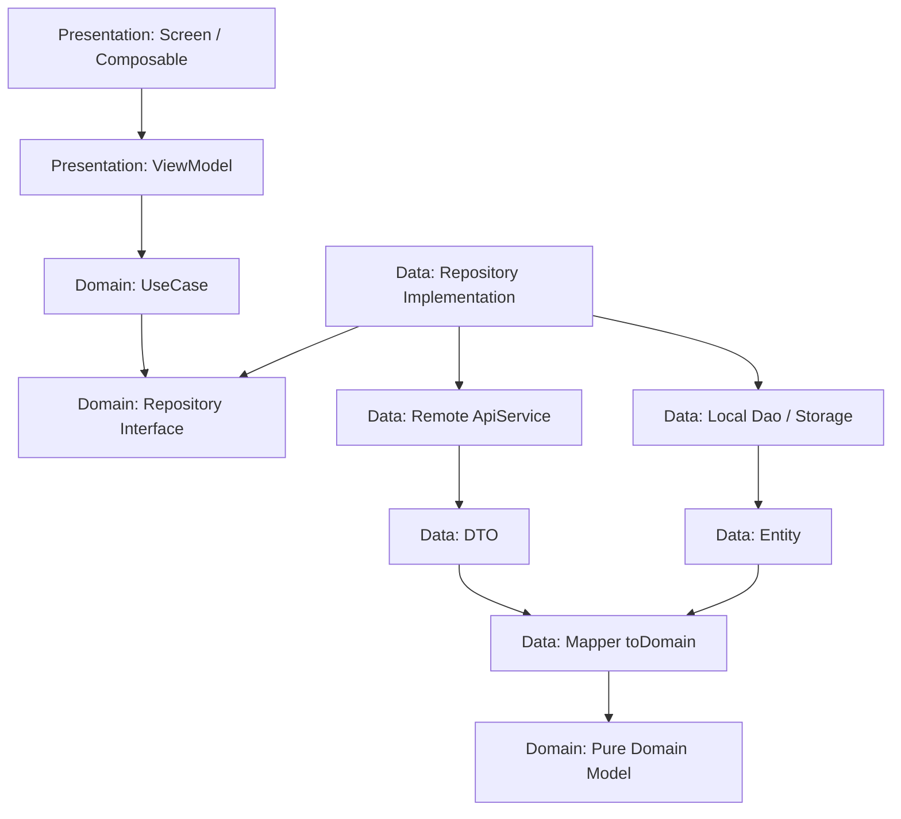

# 🏛️ Android Clean Architecture Skill

This skill enforces **Clean Architecture** across all layers of an Android application: **Domain**,
**Data**, and **Presentation**. It guarantees strict separation of concerns, testability,
maintainability, and unidirectional dependency.

---

## 🚨 Critical Architectural Rules

### 1. ViewModel MUST Use UseCases (Strict Requirement)

- **ViewModels MUST NEVER inject or reference Repository classes directly**.
- All data access and business logic from the ViewModel must go through dedicated **UseCases** in
  the Domain layer.
- One UseCase represents one discrete business action (Single Responsibility Principle).

### 2. Dependency Inversion & Layer Boundaries

- **Presentation Layer** depends ONLY on the **Domain Layer** (UseCases, Domain Models).
- **Data Layer** depends on the **Domain Layer** (implements Domain Repository interfaces).
- **Domain Layer** depends on **NOTHING** (pure Kotlin module with zero dependencies on Android
  framework, UI, or Data details).

### 3. Separation of Models & Mappers

- **Domain Models**: Pure Kotlin `data class` without network annotations (`@SerializedName`,
  `@Json`) or database annotations (`@Entity`, `@ColumnInfo`).
- **DTOs / Entities**: Live exclusively in the Data layer.
- **Mappers**: Pure extension functions (`toDomain()`, `toEntity()`) convert DTOs and database
  Entities into pure Domain Models before reaching the Domain layer.

### 4. Main-Safety & Coroutine Dispatchers

- All Repository functions must be **main-safe**: long-running I/O and database operations must
  execute on background threads (`Dispatchers.IO`), utilizing Room/Retrofit built-in suspend
  dispatching or `withContext(Dispatchers.IO)`.
- ViewModels safely execute asynchronous UseCases via their coroutine scope (`launchIO { }` or
  `viewModelScope.launch { }`).

### 5. Zero Comments in Code

- **Never write comments in code** (no `// ...`, `/* ... */`, or `// TODO`).
- Code must be self-documenting through clear, expressive naming and explicit types.

### 6. Clean Top-Level Imports (No Inline Fully Qualified Names)

- All classes, interfaces, objects, and types must be explicitly imported at the top of the file.
- **NEVER use inline fully qualified names (FQN)** like `com.hyper.artis.ai.art.generator.domain...`
  in function signatures or method bodies. Keep code clean and readable.

---

## 📁 Clean Architecture Package Structure

```
<your_package_name>/
├── domain/
│   ├── model/                  
│   │   ├── common/             # AppResult, PublicError, PaginationQuery
│   │   └── <feature>/          # FeatureModel, FeatureItem
│   ├── repository/             # Interfaces ONLY (e.g., FeatureRepository)
│   └── usecase/
│       └── <feature>/          # GetFeatureItemsUseCase, UpdateFeatureUseCase
├── data/
│   ├── network/
│   │   ├── service/            # Retrofit API interfaces (e.g., FeatureApiService)
│   │   └── model/              # DTOs with @SerializedName + toDomain() mappers
│   ├── local/
│   │   ├── dao/                # Room DAOs
│   │   └── entity/             # Room @Entity classes + toDomain() mappers
│   ├── repository/             # Repository implementations (e.g., FeatureRepositoryImpl)
│   └── di/                     # Hilt Modules (@Binds repository interfaces)
└── ui/
    └── component/screen/<feature>/
        ├── <Feature>Contract.kt
        ├── <Feature>ViewModel.kt # Injects UseCases ONLY
        └── <Feature>Screen.kt
```

---

## 🧱 Layer Implementation Guidelines



---

## 🛠️ Step-by-Step Layer Templates

### 1. Domain Layer

#### A. Common Result & Error Wrappers (`domain/model/common/`)

```kotlin
package <your_package_name>.domain.model.common

sealed interface AppResult<out T> {
    data class Success<T>(val data: T) : AppResult<T>
    data class Failure(val error: PublicError) : AppResult<Nothing>
}
```

```kotlin
package <your_package_name>.domain.model.common

sealed interface PublicError {
    data object NetworkUnavailable : PublicError
    data object ServerError : PublicError
    data object NotFound : PublicError
    data object Unauthorized : PublicError
    data object InvalidInput : PublicError
    data class Unknown(val message: String? = null) : PublicError

    companion object {
        fun fromThrowable(throwable: Throwable): PublicError {
            return Unknown(throwable.localizedMessage)
        }
    }
}
```

#### B. Pure Domain Model (`domain/model/<feature>/<Feature>Item.kt`)

```kotlin
package <your_package_name>.domain.model.<feature>

data class <Feature>Item(
    val id: String,
    val title: String,
    val description: String,
    val createdAt: Long
)
```

#### C. Repository Interface (`domain/repository/<Feature>Repository.kt`)

```kotlin
package <your_package_name>.domain.repository

import kotlinx.coroutines.flow.Flow
import <your_package_name>.domain.model.common.AppResult
import <your_package_name>.domain.model.<feature>.<Feature>Item

interface <Feature>Repository {
    fun getItemsFlow(): Flow<List<<Feature>Item>>
    suspend fun fetchItems(forceRefresh: Boolean): AppResult<List<<Feature>Item>>
    suspend fun getItemById(id: String): AppResult<<Feature>Item>
    suspend fun updateItem(id: String, title: String): AppResult<Unit>
    suspend fun deleteItem(id: String): AppResult<Unit>
}
```

#### D. Domain UseCases (`domain/usecase/<feature>/...`)

- **Continuous Reactive Observation (Flow)**:

```kotlin
package <your_package_name>.domain.usecase.<feature>

import kotlinx.coroutines.flow.Flow
import <your_package_name>.domain.model.<feature>.<Feature>Item
import <your_package_name>.domain.repository.<Feature>Repository
import javax.inject.Inject

class Observe<Feature>ItemsUseCase @Inject constructor(
    private val repository: <Feature>Repository
) {
    operator fun invoke(): Flow<List<<Feature>Item>> =
        repository.getItemsFlow()
}
```

- **One-Shot Fetching & Mutations**:

```kotlin
package <your_package_name>.domain.usecase.<feature>

import <your_package_name>.domain.model.common.AppResult
import <your_package_name>.domain.model.<feature>.<Feature>Item
import <your_package_name>.domain.repository.<Feature>Repository
import javax.inject.Inject

class Get<Feature>ItemsUseCase @Inject constructor(
    private val repository: <Feature>Repository
) {
    suspend operator fun invoke(forceRefresh: Boolean = false): AppResult<List<<Feature>Item>> =
        repository.fetchItems(forceRefresh)
}
```

```kotlin
package <your_package_name>.domain.usecase.<feature>

import <your_package_name>.domain.model.common.AppResult
import <your_package_name>.domain.model.common.PublicError
import <your_package_name>.domain.repository.<Feature>Repository
import javax.inject.Inject

class Update<Feature>ItemUseCase @Inject constructor(
    private val repository: <Feature>Repository
) {
    suspend operator fun invoke(id: String, title: String): AppResult<Unit> {
        if (title.isBlank()) {
            return AppResult.Failure(PublicError.InvalidInput)
        }
        return repository.updateItem(id, title.trim())
    }
}
```

---

### 2. Data Layer

#### A. Data Transfer Object & Mapper (`data/network/model/<Feature>Dto.kt`)

```kotlin
package <your_package_name>.data.network.model

import com.google.gson.annotations.SerializedName
import <your_package_name>.domain.model.<feature>.<Feature>Item

data class <Feature>Dto(
    @SerializedName("id") val id: String?,
    @SerializedName("title") val title: String?,
    @SerializedName("description") val description: String?,
    @SerializedName("created_at") val createdAt: Long?
)

fun <Feature>Dto.toDomain(): <Feature>Item = <Feature>Item(
    id = id.orEmpty(),
    title = title.orEmpty(),
    description = description.orEmpty(),
    createdAt = createdAt ?: 0L
)

fun List<<Feature>Dto>.toDomain(): List<<Feature>Item> = map { it.toDomain() }
```

#### B. Remote API Service (`data/network/service/<Feature>ApiService.kt`)

```kotlin
package <your_package_name>.data.network.service

import retrofit2.http.Body
import retrofit2.http.DELETE
import retrofit2.http.GET
import retrofit2.http.POST
import retrofit2.http.Path
import retrofit2.http.Query
import <your_package_name>.data.network.model.<Feature>Dto
import <your_package_name>.data.network.model.<Feature>ResponseDto

interface <Feature>ApiService {
    @GET("api/v1/<feature>")
    suspend fun getItems(@Query("page") page: Int): <Feature>ResponseDto

    @POST("api/v1/<feature>/{id}")
    suspend fun updateItem(
        @Path("id") id: String,
        @Body request: UpdateItemRequestDto
    )

    @DELETE("api/v1/<feature>/{id}")
    suspend fun deleteItem(@Path("id") id: String)
}
```

#### C. Repository Implementation (`data/repository/<Feature>RepositoryImpl.kt`)

```kotlin
package <your_package_name>.data.repository

import kotlinx.coroutines.flow.Flow
import kotlinx.coroutines.flow.map
import <your_package_name>.data.local.dao.<Feature>Dao
import <your_package_name>.data.local.entity.toDomain
import <your_package_name>.data.local.entity.toEntity
import <your_package_name>.data.network.model.toDomain
import <your_package_name>.data.network.service.<Feature>ApiService
import <your_package_name>.domain.model.common.AppResult
import <your_package_name>.domain.model.common.PublicError
import <your_package_name>.domain.model.<feature>.<Feature>Item
import <your_package_name>.domain.repository.<Feature>Repository
import javax.inject.Inject
import javax.inject.Singleton

@Singleton
class <Feature>RepositoryImpl @Inject constructor(
    private val apiService: <Feature>ApiService,
    private val localDao: <Feature>Dao
) : <Feature>Repository {

    override fun getItemsFlow(): Flow<List<<Feature>Item>> =
        localDao.observeItems().map { it.toDomain() }

    override suspend fun fetchItems(forceRefresh: Boolean): AppResult<List<<Feature>Item>> {
        return try {
            val response = apiService.getItems(page = 1)
            val domainItems = response.items.toDomain()
            localDao.insertAll(domainItems.map { it.toEntity() })
            AppResult.Success(domainItems)
        } catch (exception: Exception) {
            val cached = localDao.getAllItems()
            if (cached.isNotEmpty()) {
                AppResult.Success(cached.toDomain())
            } else {
                AppResult.Failure(PublicError.fromThrowable(exception))
            }
        }
    }

    override suspend fun getItemById(id: String): AppResult<<Feature>Item> {
        val cached = localDao.getItemById(id)
        if (cached != null) {
            return AppResult.Success(cached.toDomain())
        }
        return AppResult.Failure(PublicError.NotFound)
    }

    override suspend fun updateItem(id: String, title: String): AppResult<Unit> {
        return try {
            apiService.updateItem(id, UpdateItemRequestDto(title))
            localDao.updateTitle(id, title)
            AppResult.Success(Unit)
        } catch (exception: Exception) {
            AppResult.Failure(PublicError.fromThrowable(exception))
        }
    }

    override suspend fun deleteItem(id: String): AppResult<Unit> {
        return try {
            apiService.deleteItem(id)
            localDao.deleteById(id)
            AppResult.Success(Unit)
        } catch (exception: Exception) {
            AppResult.Failure(PublicError.fromThrowable(exception))
        }
    }
}
```

#### D. Dependency Injection Module (`data/di/<Feature>Module.kt`)

```kotlin
package <your_package_name>.data.di

import dagger.Binds
import dagger.Module
import dagger.hilt.InstallIn
import dagger.hilt.components.SingletonComponent
import <your_package_name>.data.repository.<Feature>RepositoryImpl
import <your_package_name>.domain.repository.<Feature>Repository
import javax.inject.Singleton

@Module
@InstallIn(SingletonComponent::class)
abstract class <Feature>DataModule {

    @Binds
    @Singleton
    abstract fun bind<Feature>Repository(
        impl: <Feature>RepositoryImpl
    ): <Feature>Repository
}
```

---

### 3. Presentation Layer (ViewModel Integration)

#### ViewModel Consumes UseCases ONLY (`ui/component/screen/<feature>/<Feature>ViewModel.kt`)

```kotlin
package <your_package_name>.ui.component.screen.<feature>

import dagger.hilt.android.lifecycle.HiltViewModel
import <your_package_name>.domain.model.common.AppResult
import <your_package_name>.domain.usecase.<feature>.Get<Feature>ItemsUseCase
import <your_package_name>.domain.usecase.<feature>.Update<Feature>ItemUseCase
import <your_package_name>.ui.bases.compose.mvi.BaseComposeViewModel
import javax.inject.Inject

@HiltViewModel
class <Feature>ViewModel @Inject constructor(
    private val get<Feature>ItemsUseCase: Get<Feature>ItemsUseCase,
    private val update<Feature>ItemUseCase: Update<Feature>ItemUseCase
) : BaseComposeViewModel<<Feature>UiState, <Feature>Intent, <Feature>Effect>(<Feature>UiState()) {

    override fun handleIntent(intent: <Feature>Intent) {
        when (intent) {
            <Feature>Intent.Initialize -> loadData(forceRefresh = false)
            <Feature>Intent.Refresh -> loadData(forceRefresh = true)
            <Feature>Intent.Retry -> loadData(forceRefresh = true)
            is <Feature>Intent.UpdateTitle -> updateTitle(intent.id, intent.newTitle)
            is <Feature>Intent.SelectItem -> {
                sendEffect(<Feature>Effect.NavigateToDetail(intent.id))
            }
        }
    }

    override fun dismissError() {
        updateState { copy(error = null) }
    }

    private fun loadData(forceRefresh: Boolean) {
        launchIO {
            updateState { copy(isLoading = !forceRefresh, isRefreshing = forceRefresh, error = null) }
            when (val result = get<Feature>ItemsUseCase(forceRefresh)) {
                is AppResult.Success -> {
                    updateState {
                        copy(
                            isLoading = false,
                            isRefreshing = false,
                            items = result.data,
                            error = null
                        )
                    }
                }
                is AppResult.Failure -> {
                    updateState {
                        copy(
                            isLoading = false,
                            isRefreshing = false,
                            error = result.error
                        )
                    }
                }
            }
        }
    }

    private fun updateTitle(id: String, newTitle: String) {
        launchIO {
            when (val result = update<Feature>ItemUseCase(id, newTitle)) {
                is AppResult.Success -> {
                    loadData(forceRefresh = true)
                }
                is AppResult.Failure -> {
                    sendEffect(<Feature>Effect.ShowToast(result.error))
                }
            }
        }
    }
}
```

---

## 📋 Quality Checklist for Clean Architecture

Before finishing any feature implementation, verify each point:

- [ ] **ViewModel Boundary**:
    - Does the ViewModel inject ONLY UseCases?
    - Are there ZERO direct injections of Repository, ApiService, DAO, or Context into the
      ViewModel?
- [ ] **Domain Purity**:
    - Are all Domain Models free of framework annotations (`@SerializedName`, `@Entity`, etc.)?
    - Does the Domain layer have ZERO imports of `android.*` or Data layer classes?
    - Is each business operation separated into its own UseCase with an `operator fun invoke`?
- [ ] **Data Layer Encapsulation**:
    - Do all network DTOs and database Entities convert to Domain Models via explicit `toDomain()`
      mappers?
    - Does the Repository implementation implement the interface defined in `domain/repository/`?
    - Is the repository bound using Hilt's `@Binds` in a `@Module`?
- [ ] **Code Hygiene**:
    - Are there ZERO comments (`//`, `/* */`, `TODO`) anywhere in the code?
    - Are all types, parameters, and error branches handled explicitly?
