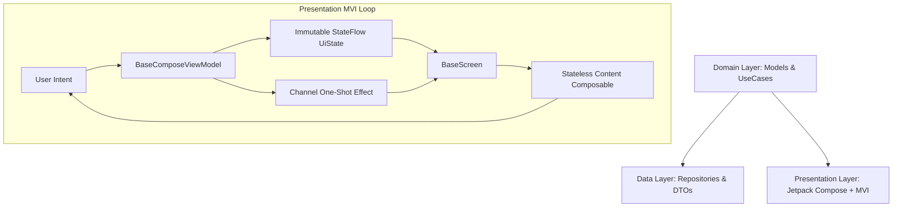

# 🚀 Android Jetpack Compose & MVI Clean Architecture Skill

This skill governs all Jetpack Compose development in this codebase. It enforces **Clean
Architecture**, the **MVI (Model-View-Intent)** presentation pattern, the **Figma 402px Responsive
Scaling Dimension System (`SdpR_*`)**, and the project's standard UI design system.

> [!NOTE]
> **Ad components and ad logic are excluded** from this skill. Focus strictly on Clean Architecture,
> business domain logic, and clean Compose UI.

---

## 🏛️ Architecture Overview

The codebase strictly follows **Clean Architecture** with a unidirectional data flow:



---

## 📁 Package & File Structure

Every Compose feature screen lives under `ui/component/screen/<feature_name>/` and must be organized
as follows:

```
ui/component/screen/<feature_name>/
├── <Feature>Contract.kt
├── <Feature>ViewModel.kt
├── <Feature>Screen.kt
└── component/
    ├── <Feature>ItemCard.kt
    └── <Feature>Section.kt
```

---

## 🚨 Critical Development Rules

### 1. Luôn phải viết `@Preview` cho View (Mandatory `@Preview`)

- **Tất cả các Composable View / Component / Screen / Dialog / BottomSheet đều BẮT BUỘC phải
  có `@Preview`**.
- Với màn hình, viết `@Preview` cho hàm stateless `*Content(state = ..., onIntent = ...)`.
- Với các component con (`ItemCard`, `Section`, `Dialog`), luôn tạo private `@Preview` với dữ liệu
  mẫu hoàn chỉnh.

### 2. Không được comment trong code (Zero Comments in Code)

- **TUYỆT ĐỐI KHÔNG VIẾT COMMENT trong code** (không dùng `// ...`, `/* ... */`, hay `// TODO`).
- Code phải tự giải thích thông qua cách đặt tên hàm, biến, model rõ ràng, tường minh và chuẩn clean
  architecture.

### 3. Tối ưu danh sách (LazyList / LazyGrid Keys & ContentType)

- Khi sử dụng `LazyColumn`, `LazyRow`, `LazyVerticalGrid`, **bắt buộc luôn khai báo `key`
  và `contentType`**:
    - `key`: Dùng unique ID ổn định của item (tránh dùng `index` khi danh sách có thể thay đổi).
    - `contentType`: Nhóm các item cùng loại layout để Compose tái sử dụng Composable slot hiệu quả.

### 4. State Hoisting & Navigation Callbacks

- Screen cấp cao quản lý ViewModel và `BaseScreen`.
- Content Composable cấp dưới là stateless: chỉ nhận `state` và lambda callback
  `onIntent: (Intent) -> Unit`.
- Không truyền `NavController` vào sâu bên trong child components; chỉ truyền lambda event điều
  hướng (`onBack: () -> Unit`, `onItemClick: (String) -> Unit`).

### 5. Tuyệt đối không dùng Fully Qualified Name (FQN) trong thân code - Bắt buộc import lên đầu file

- **Tất cả các Class, Composable, Interface, Object, Routes (ví
  dụ: `AppRoutes`, `Screen`, `ViewModel`, `Colors`, `Icons`, `UseCase`...) BẮT BUỘC phải được import
  rõ ràng ở đầu file (`import ...`)**.
- **TUYỆT ĐỐI KHÔNG GỌI kiểu inline FQN dài dòng trong thân code/hàm**, ví dụ:
    - ❌ **CẤM**:
      `rootNavController.navigate(com.hyper.artis.ai.art.generator.ui.bases.navigation.AppRoutes.expandRoute(...))`
    - ❌ **CẤM**: `com.hyper.artis.ai.art.generator.ui.component.screen.enhance.EnhanceScreen(...)`
    - ✅ **ĐÚNG**: Đặt `import com.hyper.artis.ai.art.generator.ui.bases.navigation.AppRoutes` ở đầu
      file và gọi `rootNavController.navigate(AppRoutes.expandRoute(...))`.

### 6. Tuyệt đối tuân thủ tỉ lệ & chi tiết Figma - Cấm tự ý kéo giãn làm lệch layout (Strict Design & Aspect Ratio Fidelity)

- **BẮT BUỘC soi kỹ thiết kế Figma / ảnh mockup trước khi code**:
    - Đo đạc chính xác tỉ lệ khung hình (**Aspect Ratio**, ví dụ: `3:4`, `1:1`, `16:9`...) của card,
      ảnh, container.
    - **TUYỆT ĐỐI KHÔNG tự ý dùng `Modifier.weight(1f)` hoặc `fillMaxSize()`** để kéo giãn container
      làm biến dạng tỉ lệ khung hình so với mockup.
    - Phân tích kỹ các lớp viền lồng nhau (**Inset borders**), viền nét đứt (**dashed border**), bo
      góc và khoảng cách đệm (**padding / spacing**).
    - Giữ khoảng thở hợp lý bằng `Spacer` đúng vị trí như thiết kế, không tự ý kéo căng layout phủ
      kín màn hình.
- **Quy tắc kiểm tra biên dịch (Build & Syntax Check)**:
    - **ĐƯỢC PHÉP và NÊN kiểm tra lỗi cú pháp bằng lệnh compile nhẹ**:
      `./gradlew :app:compileDevDebugKotlin` để bắt lỗi syntax, missing import, type mismatch ngay
      khi code xong.
    - **TUYỆT ĐỐI KHÔNG tự ý chạy lệnh đóng gói build APK (`assembleDevDebug`, `packageDevDebug`...)
      ** trừ khi người dùng yêu cầu trực tiếp.

---

## 📐 Dimension & Typography System (MANDATORY)

Layouts are designed against a **Figma canvas width of 402f** (`FIGMA_WIDTH = 402f` in
`ComposeDimens.kt`).

### 1. Kích thước Dp (`SdpR_*`)

- **NEVER** use hardcoded raw `dp` (e.g., `16.dp`, `24.dp`, `Modifier.height(50.dp)`).
- **ALWAYS** use the responsive scaled dimension constants `SdpR_<N>` from:
  `<your_package_name>.ui.bases.compose.theme.SdpR_*`
  *(e.g., `SdpR_1`, `SdpR_4`, `SdpR_8`, `SdpR_12`, `SdpR_16`, `SdpR_20`, `SdpR_24`, `SdpR_48`,
  `SdpR_56`, etc.)*.

### 2. Cỡ chữ Sp (`nonScaledSp`)

- **NEVER** use standard Android `sp` (e.g., `14.sp`, `16.sp`). Standard `sp` causes layout breaks
  when users alter OS font display scaling.
- **ALWAYS** use `.nonScaledSp` extension on `SdpR_*`:
  ```kotlin
  fontSize = SdpR_14.nonScaledSp
  lineHeight = SdpR_18.nonScaledSp
  ```

### 3. Phông chữ (Font Families)

- **Do not use arbitrary or ad-hoc system fonts**.
- **Always use the project's designated font tokens** defined in the theme layer (e.g.,
  `<your_package_name>.ui.bases.compose.theme.*` or `Theme.kt`).
- Map appropriate font weights (Regular, Medium, SemiBold, Bold, ExtraBold) according to the design
  system hierarchy.

### 4. Màu sắc & Gradients (Theme & Color Tokens)

- Centralize all colors in the project's theme palette (e.g., `ComposeColors.kt` or `Color.kt`).
- Avoid scattering magic/arbitrary raw hex literals (`Color(0xFF123456)`) across UI files; reference
  defined color constants and brand gradients.

## 🧩 Design System & Component Reusability

Before creating new UI elements, inspect the target project's design system or base components
directory (`ui/bases/compose/component/`, `designsystem/`, or `ui/component/common/`):

- **Use Existing Project Components If Present**:
  If the project provides custom design system wrappers (such as custom Buttons, custom Text
  components with gradient support, shared TopBars, or custom AsyncImage loaders), **always
  prioritize reusing them** to ensure visual consistency across the app.
- **Fallback to Standard Jetpack Compose / Material3**:
  If the project does not define custom component wrappers, use standard Compose components (`Text`,
  `Button`, `IconButton`, `TopAppBar`, `AsyncImage`, etc.) while strictly applying:
    - Responsive scaled sizing (`SdpR_*`)
    - Non-scaled typography (`.nonScaledSp`)
    - Project Theme color and font tokens

## 🛠️ Step-by-Step Implementation Templates

### 1. Contract Template (`<Feature>Contract.kt`)

```kotlin
package <your_package_name>.ui.component.screen.<feature>

import androidx.compose.runtime.Immutable
import <your_package_name>.domain.model.common.PublicError
import <your_package_name>.ui.bases.compose.mvi.BaseUiState

@Immutable
data class <Feature>UiState(
    override val isLoading: Boolean = false,
    override val error: PublicError? = null,
    val items: List<ItemModel> = emptyList(),
    val isRefreshing: Boolean = false
) : BaseUiState

sealed interface <Feature>Intent {
    data object Initialize : <Feature>Intent
    data object Refresh : <Feature>Intent
    data object Retry : <Feature>Intent
    data class ClickItem(val id: String) : <Feature>Intent
    data object NavigateBack : <Feature>Intent
}

sealed interface <Feature>Effect {
    data class NavigateDetail(val id: String) : <Feature>Effect
    data object NavigateBack : <Feature>Effect
    data class ShowToast(val messageRes: Int) : <Feature>Effect
}
```

### 2. ViewModel Template (`<Feature>ViewModel.kt`)

```kotlin
package <your_package_name>.ui.component.screen.<feature>

import <your_package_name>.domain.model.common.AppResult
import <your_package_name>.domain.usecase.<feature>.GetItemsUseCase
import <your_package_name>.ui.bases.compose.mvi.BaseComposeViewModel
import dagger.hilt.android.lifecycle.HiltViewModel
import javax.inject.Inject

@HiltViewModel
class <Feature>ViewModel @Inject constructor(
    private val getItemsUseCase: GetItemsUseCase
) : BaseComposeViewModel<<Feature>UiState, <Feature>Intent, <Feature>Effect>(<Feature>UiState()) {

    override fun handleIntent(intent: <Feature>Intent) {
        when (intent) {
            <Feature>Intent.Initialize -> loadData()
            <Feature>Intent.Refresh -> loadData(forceRefresh = true)
            <Feature>Intent.Retry -> loadData()
            is <Feature>Intent.ClickItem -> {
                sendEffect(<Feature>Effect.NavigateDetail(intent.id))
            }
            <Feature>Intent.NavigateBack -> {
                sendEffect(<Feature>Effect.NavigateBack)
            }
        }
    }

    override fun dismissError() {
        updateState { copy(error = null) }
    }

    private fun loadData(forceRefresh: Boolean = false) {
        launchIO {
            updateState { copy(isLoading = !forceRefresh, isRefreshing = forceRefresh, error = null) }
            when (val result = getItemsUseCase(forceRefresh)) {
                is AppResult.Success -> {
                    updateState {
                        copy(
                            isLoading = false,
                            isRefreshing = false,
                            items = result.data,
                            error = null
                        )
                    }
                }
                is AppResult.Failure -> {
                    updateState {
                        copy(
                            isLoading = false,
                            isRefreshing = false,
                            error = result.error
                        )
                    }
                }
            }
        }
    }
}
```

### 3. Screen Template (`<Feature>Screen.kt`)

```kotlin
package <your_package_name>.ui.component.screen.<feature>

import androidx.compose.foundation.layout.Box
import androidx.compose.foundation.layout.Column
import androidx.compose.foundation.layout.fillMaxSize
import androidx.compose.foundation.layout.padding
import androidx.compose.runtime.Composable
import androidx.compose.runtime.LaunchedEffect
import androidx.compose.ui.Modifier
import androidx.compose.ui.res.stringResource
import androidx.compose.ui.tooling.preview.Preview
import androidx.compose.foundation.layout.Row
import androidx.compose.foundation.layout.fillMaxWidth
import androidx.compose.material3.Text
import androidx.hilt.lifecycle.viewmodel.compose.hiltViewModel
import <your_package_name>.R
import <your_package_name>.ui.bases.compose.mvi.BaseScreen
import <your_package_name>.ui.bases.compose.theme.SdpR_12
import <your_package_name>.ui.bases.compose.theme.SdpR_16
import <your_package_name>.ui.bases.compose.theme.SdpR_18
import <your_package_name>.ui.bases.compose.theme.nonScaledSp

@Composable
fun <Feature>Screen(
    fromScreen: String? = null,
    onBack: () -> Unit,
    onOpenDetail: (String) -> Unit = {},
    viewModel: <Feature>ViewModel = hiltViewModel()
) {
    LaunchedEffect(viewModel) {
        viewModel.handleIntent(<Feature>Intent.Initialize)
    }

    BaseScreen(
        viewModel = viewModel,
        screenName = "<Feature>Screen",
        fromScreen = fromScreen,
        errorTitleRes = R.string.general_error_title,
        onRetryError = { viewModel.handleIntent(<Feature>Intent.Retry) },
        onEffect = { effect ->
            when (effect) {
                is <Feature>Effect.NavigateDetail -> onOpenDetail(effect.id)
                <Feature>Effect.NavigateBack -> onBack()
                is <Feature>Effect.ShowToast -> Unit
            }
        }
    ) { state, onIntent ->
        <Feature>Content(
            state = state,
            onIntent = onIntent
        )
    }
}

@Composable
fun <Feature>Content(
    state: <Feature>UiState,
    onIntent: (<Feature>Intent) -> Unit,
    modifier: Modifier = Modifier
) {
    Column(modifier = modifier.fillMaxSize()) {
        Row(
            modifier = Modifier
                .fillMaxWidth()
                .padding(horizontal = SdpR_16, vertical = SdpR_12)
        ) {
            Text(
                text = stringResource(R.string.feature_title),
                fontSize = SdpR_18.nonScaledSp,
                modifier = Modifier.weight(1f)
            )
        }

        Box(
            modifier = Modifier
                .weight(1f)
                .padding(horizontal = SdpR_16)
        )
    }
}

@Preview(showBackground = true, widthDp = 402, heightDp = 874)
@Composable
private fun <Feature>ContentPreview() {
    <Feature>Content(
        state = <Feature>UiState(),
        onIntent = {}
    )
}
```

---

## 📋 Quality Checklist for Every Compose File

When writing or reviewing Compose code in this codebase:

- [ ] **Contract Integrity**:
    - `UiState` implements `BaseUiState` with `isLoading` and `error`.
    - `UiState` is annotated with `@Immutable` or `@Stable`.
    - Intents and Effects are modeled with `sealed interface`.
- [ ] **ViewModel Standards**:
    - Extends `BaseComposeViewModel<State, Intent, Effect>`.
    - Annotated with `@HiltViewModel`.
    - Business operations are wrapped in `launchIO { }`, UI effects in `launchUI { }`.
    - Overrides `dismissError()` properly.
- [ ] **Screen & Component Conventions**:
    - Screen composable delegates UI to `BaseScreen`.
    - Screen separation: Stateful `<Feature>Screen` wraps stateless `<Feature>Content`.
    - **Mandatory `@Preview`**: Every View, Screen Content, Card, Dialog, or Component has a
      functional `@Preview`.
    - **Zero Comments**: Code contains no comments (`//`, `/* */`, or `TODO`).
- [ ] **Dimension & Typography Rules**:
    - **Zero hardcoded raw `dp`** (replaced by `SdpR_*`).
    - **Zero raw `sp`** (replaced by `SdpR_*.nonScaledSp`).
    - Proper font family assigned from the project's designated theme tokens.
- [ ] **Component Reusability & Design System**:
    - Reuses project-specific core components (custom Buttons, Text, TopBar, Image loaders) if
      defined in the codebase; otherwise uses standard Compose / Material3 components styled with
      the project's theme tokens.
    - Image loading handles placeholder and error states cleanly.
- [ ] **Design & Aspect Ratio Fidelity**:
    - Strictly preserves original Figma / mockup aspect ratios (`aspectRatio(...)`) without
      arbitrary vertical/horizontal stretching.
    - Inset borders, corner radiuses, and padding match design pixel-for-pixel.
- [ ] **Build & Syntax Verification**:
    - Verifies code syntax via light compilation (`compileDevDebugKotlin`), NEVER runs unauthorized
      full APK packaging (`assemble...`).
- [ ] **Cleanliness**:
    - No ad-related imports or SDK calls.
    - Pure separation of UI, Domain, and Data layers.
